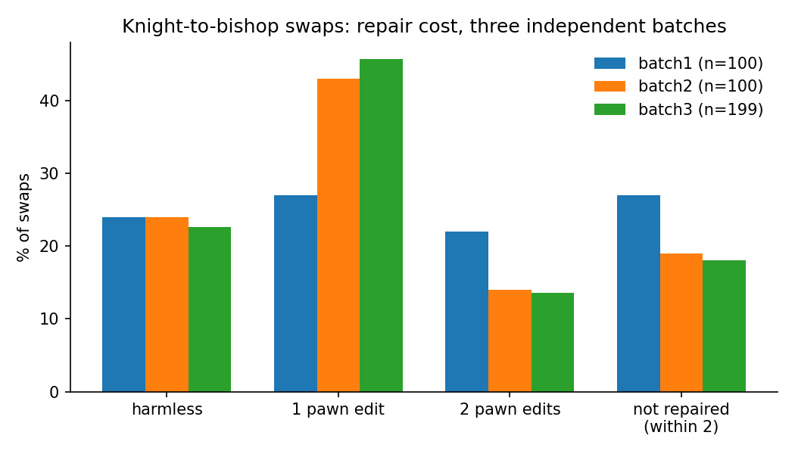
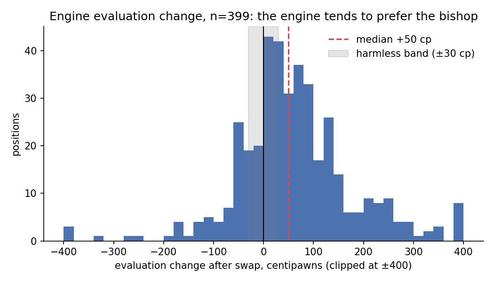

# How replaceable is a chess piece in a specific position?

Standard piece values (knight = 3, bishop = 3) are averages over millions of positions. This project measures replaceability **position by position**: replace a knight with a bishop, and ask how much of the board has to change before the engine's evaluation returns to where it was.

The idea began as my capstone design project at Ajou University in Tashkent (2026), where I analysed famous grandmaster positions by hand. This repository contains the automated study that followed.

## Method

For each position (move 20 of a grandmaster game, side to move has a knight):

1. **E0**: Stockfish 16 evaluates the real position (fixed depth 12).
2. **Swap**: the knight is replaced by a bishop of the same colour on the same square.
3. **E1**: the swapped position is evaluated. *Damage* = E1 − E0 (positive means the engine prefers the bishop).
4. **Repair**: a greedy search shifts the swapping side's own pawns one square along their file, up to two edits, until the evaluation is back within 0.3 pawns of E0.

Repair cost is 0 (harmless swap), 1 or 2 edits, or "not repaired within two edits".

Filters: positions with |E0| > 3 pawns are skipped (already decided), and only **quiet** swaps are kept, where the new bishop attacks no enemy piece (see "What went wrong" below).

Data: 399 positions from 29 players, Morphy to Carlsen, in three independent batches with no position repeated.

## Results



| Repair cost | Batch 1 (n=100) | Batch 2 (n=100) | Batch 3 (n=199) | All (n=399) |
|---|---|---|---|---|
| Harmless (within 0.3 pawns) | 24% | 24% | 23% | **23%** |
| 1 pawn edit | 27% | 43% | 46% | 40% |
| 2 pawn edits | 22% | 14% | 14% | 16% |
| Not repaired within 2 edits | 27% | 19% | 18% | **21%** |

- About a quarter of knight-to-bishop swaps do not matter to the engine, and about a fifth cannot be undone with two pawn edits. The harmless share is stable across all three batches.
- **Depth check.** All 399 positions were re-evaluated at depth 18: harmless share 23% → 27%, bishop favoured 60% → 57%, median change +50 → +46 centipawns, correlation of damage across depths 0.95. The repair search itself was not repeated at depth 18.



## What went wrong, and what it taught me

- **Artifact in the first run.** Without the quiet filter, the swap "improved" the position in 68 of 100 cases, and in 31 of them the engine's best move was the new bishop capturing something immediately. The raw result measured tactics, not replaceability. That run is kept in `data/batch0_unfiltered_100.csv`.
- **Engine bias.** Even for quiet swaps the engine prefers the bishop (median +0.5 pawns, 60% of swaps). The effect depends on the bishop configuration: largest when the swap creates the bishop pair (+0.78, 95% CI +0.52 to +1.29), smallest with two same-coloured bishops (+0.18). The size of the pair effect did not replicate well between batches.
- **Offset correction failed.** Subtracting per-configuration offsets estimated on batches 1 and 2 did not work on batch 3 (it over-corrected to −0.22 and barely reduced the spread). The bias is not a fixed number per configuration.
- **No closed/open difference.** Using a hand-made definition (at least two locked pawn pairs), closed and open positions did not differ (p = 0.31, n = 399). This may say more about the definition than about chess.

## Limitations

- Replaceability here means "as seen by Stockfish 16 at a fixed depth", not chess truth.
- The repair edit space (pawn shifts along a file, at most two) is a modelling choice; "not repaired" can mean the edit space was too small.
- Only one substitution type (knight → bishop) and one move number (20).

## Reproduce

Everything runs in Google Colab: open `notebooks/reproduce_in_colab.ipynb`.

Locally:

```bash
sudo apt-get install stockfish          # or set --engine to your Stockfish path
pip install -r requirements.txt
git clone --depth 1 https://github.com/Dragjon/chessdatabase.git

PYTHONPATH=src python src/analyze.py        # all numbers above, from the saved CSVs
PYTHONPATH=src python src/make_figures.py   # the two figures
python src/depth_check.py 18 399            # depth verification (about 17 min)
PYTHONPATH=src python src/run_study.py --pgn-dir chessdatabase/chess-games \
    --n 100 --seed 45 --exclude data/batch*_*.csv --out data/batch4_100.csv
```

## Repository structure

```
src/replaceability.py   core logic: evaluation, swap, quiet filter, repair search
src/run_study.py        collect positions and run one batch
src/analyze.py          the four tests and every reported number
src/depth_check.py      re-evaluation at deeper search
src/make_figures.py     figures in results/
data/                   one CSV per batch (FEN, evaluations, repair cost, edits)
notebooks/              Colab notebook
```

## Credits and notes

- Games: [Dragjon/chessdatabase](https://github.com/Dragjon/chessdatabase) (MIT), originally from [pgnmentor.com](https://www.pgnmentor.com/files.html).
- Tools: [python-chess](https://github.com/niklasf/python-chess), [Stockfish 16](https://stockfishchess.org/).
- The automated pipeline was prototyped with the help of an AI assistant (Claude). I reviewed the code, ran the depth verification myself, and am responsible for the analysis and its interpretation.

Davronbek Toshpulatov · Tashkent, Uzbekistan
